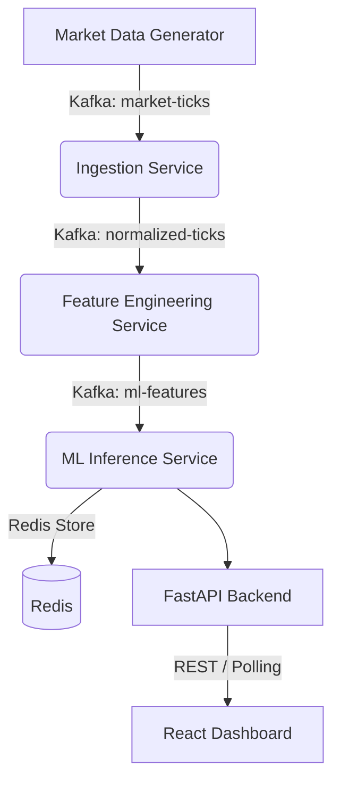

# Ultra-Low-Latency ML Signal Pipeline

This project simulates a production-grade high-frequency trading (HFT) infrastructure. Market signals are generated, processed via stream processing, inferred using a Scikit-Learn ML model, and served to a real-time React dashboard.

The entire system is deployed through an automated Jenkins CI/CD pipeline, gated by an inference latency benchmark, and orchestrated via Kubernetes simulating multi-region active-active failover.

## Architecture



### Microservices
1. **Market Data Generator**: Simulates 1000+ ticks/sec and pushes to Kafka.
2. **Ingestion Service**: FastAPI + Kafka consumer validating and normalizing tick data.
3. **Feature Engineering**: Stateful Kafka consumer generating moving averages, volatility, and deltas.
4. **ML Inference Service**: FastAPI app that loads a `joblib` Scikit-Learn model, predicts BUY/SELL/HOLD on the feature stream, and logs microsecond inference latency to Redis.
5. **Dashboard**: React + Vite UI utilizing modern glassmorphism design.

## Setup Instructions

### 1. Local Development (Docker Compose)
To run the full stack locally:
```bash
docker-compose up --build -d
```
Access the services:
- Dashboard: http://localhost:3000 (Note: run `npm i && npm run dev` inside `dashboard/` locally to view it, or proxy it)
- Inference API: http://localhost:8001/api/signals
- Ingestion Health: http://localhost:8000/health

### 2. Kubernetes Deployment
To deploy to a Kubernetes cluster (e.g., Minikube / Docker Desktop K8s):

```bash
# 1. Create namespaces
kubectl apply -f k8s/00-namespaces.yaml

# 2. Deploy Kafka & Redis
kubectl apply -f k8s/01-redis.yaml
kubectl apply -f k8s/02-kafka.yaml

# Wait for Kafka to be ready

# 3. Deploy microservices
kubectl apply -f k8s/
```

### 3. Jenkins CI/CD
The `jenkins/Jenkinsfile` defines the entire pipeline:
1. **Checkout & Test**
2. **Build Docker Images**
3. **Latency Benchmark Gate**: Spins up ephemeral docker-compose stack, runs `scripts/benchmark.py`. Fails pipeline if P99 latency > 500us.
4. **Deploy to K8s**: Updates manifests with new image tags and applies them.

### 4. Monitoring (Prometheus & Grafana)
The system exports metrics from the FastAPI services.
- `monitoring/prometheus.yml` provides the scrape config.
- Import `monitoring/grafana/provisioning/` into Grafana to automatically provision the Prometheus datasource and dashboards.

### 5. Active-Active Failover Simulation
The project supports multi-region namespace deployments (`us-east`, `us-west`).
Run the chaos testing script to simulate region failure:
```bash
python scripts/simulate_failover.py
```
This randomly kills pods and allows you to observe Kubernetes ReplicaSets automatically healing the infrastructure, while Kafka consumer groups rebalance without data loss.

## Performance
- Target Inference Latency: **< 500 microseconds**
- Framework Overhead: Minimized using `time.perf_counter()` and async loops.
- Throughput: Scales horizontally using Kubernetes HPA based on CPU utilization.
